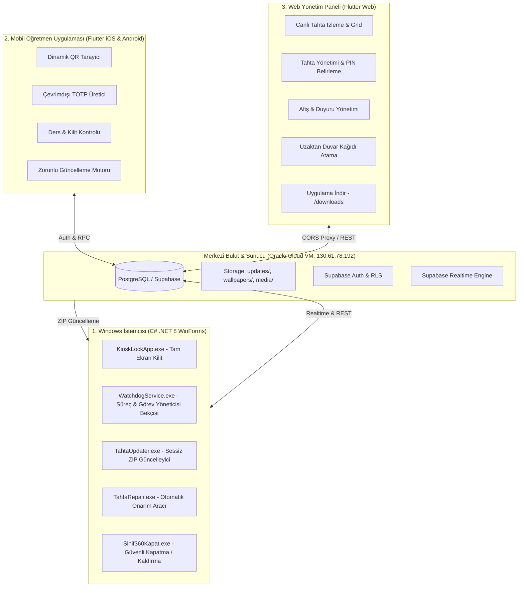

# SINIF360 MİMARİ İLKELER VE GELİŞTİRME PROTOKOLÜ
(SINIF360 ARCHITECTURE & DEVELOPMENT PROTOCOL)

Bu belge; Sınıf360 Akıllı Tahta Yönetim, Güvenlik ve Kilit Ekosistemi üzerinde yapılacak **TÜM** kodlama, hata düzeltme, arayüz tasarımı, test, sürüm ve dağıtım işlemlerinde uyulması **ZORUNLU** olan kesin anayasal kuralları belirler.

Projeye katkı sağlayan tüm geliştiriciler ve yapay zeka asistanları bu protokoldeki kurallara harfiyen uymakla yükümlüdür.

---

## 1. PROJENİN AMACI VE 3 ANA BİLEŞENİ

Sınıf360; okullardaki etkileşimli akıllı tahtaların donanımsal ve yazılımsal güvenliğini sağlayan, ders yönetimini öğretmenlerin akıllı telefonlarına (dinamik QR kod ve çevrimdışı TOTP) bağlayan, okul yöneticilerine ve sistem yöneticilerine uzaktan yönetim, canlı izleme, afiş/duyuru rotasyonu ve uzaktan onarım sunan entegre bir ekosistemdir.

Ekosistem 3 ana platformdan ve 1 merkezi sunucudan oluşur:

---

## 2. WEB ADMİN "UYGULAMA İNDİR" (/downloads) SEKMESİ KURALI

* **KURAL (EN ÖNEMLİ DETAY):** Bu sekmeye **YALNIZCA VE KESİNLİKLE RESMİLEŞMİŞ CANLI SÜRÜMLER** eklenebilir. Geliştirme aşamasındaki, yerel testteki veya mağaza onayı bekleyen sürümler **ASLA** bu ekranda gösterilemez.
* Bir mobil veya windows sürümü resmi olarak canlıya girdiğinde şu 4 dosya aynı anda senkron olarak güncellenir:
  1. `web_admin/lib/presentation/screens/downloads_screen.dart`: `currentVersion = 'vX.Y.Z'`
  2. `web_admin/lib/core/constants/app_constants.dart`: `appVersion = 'X.Y.Z'`, `serverVersion = 'vX.Y.Z'`, `serverReleaseDate = '...'`
  3. `web_admin/pubspec.yaml`: `version: X.Y.Z+1`
  4. `web_admin/test/school_selector_and_downloads_test.dart`: `expect(DownloadsScreen.currentVersion, 'vX.Y.Z');`
* İndirilecek fiziki dosyalar Oracle VM sunucusunda (`/home/ubuntu/downloads/Sinif360_Setup.exe` ve `Sinif360_TeacherMobile.apk`) eksiksiz olarak bulunmalıdır.

---

## 3. WEB GELİŞTİRME: YEREL TEST VS. CLOUDFLARE PAGES DAĞITIMI

1. **Yerel Test İlkesi:**
   - Web panelinde yapılan tüm değişiklikler öncelikle yerel ortamda (`localhost`) test edilir (`flutter run -d chrome`).
   - `AppConstants.supabaseUrl`, yerel çalışmada doğrudan `http://130.61.78.192:8000` sunucusuna bağlanır.
2. **Kullanıcı Onayı Olmadan Canlıya Yükleme YASAKTIR:**
   - Kullanıcı açıkça *"Canlıya al"* veya *"Cloudflare'e deploy et"* talimatı vermedikçe `https://panel-sinif360.pages.dev` üzerine dağıtım yapılamaz.
3. **Canlı Yayına Alma Protokolü:**
   Kullanıcı onay verdiğinde aşağıdaki adımlar sırasıyla işletilir:
   - `cd web_admin && flutter clean && flutter pub get`
   - `flutter build web --release --no-tree-shake-icons` *(İkon fontlarının bozulmasını engellemek için `--no-tree-shake-icons` zorunludur)*
   - `Copy-Item "web\_worker.js" "build\web\_worker.js" -Force` *(Mixed-Content ve WebSocket proxy için hayati zorunluluktur)*
   - `npx wrangler pages deploy build/web --project-name=panel-sinif360 --branch=main --commit-dirty=true`
   - Oracle VM aynasının senkronizasyonu: `web_admin_bundle.tar.gz` oluşturulup `/home/ubuntu/downloads/admin/` dizinine açılır.

---

## 4. WINDOWS UZAKTAN ZIP GÜNCELLEME MODELİ İNVARYANTLARI

Akıllı tahtalar sahada kilitli çalıştığından fiziksel müdahale yapılamaz. Windows tarafında yapılacak tüm geliştirmeler uzaktan sessiz ZIP güncelleme modeline uygun olmalıdır:

1. **Hedef Dizin ve Güvenlik:**
   - Dağıtım dizini: `C:\ProgramData\AkilliTahtaKilitSistemi` (Sistem ve Gizli klasör).
   - NTFS Güvenliği: `SYSTEM = Full Control`, `Users = Read & Execute`, `Administrators & Users = (DE, DC)` (Delete & Delete Child yasağı).
2. **Derleme ve Paketleme:**
   - `dotnet publish -c Release -r win-x64 --no-self-contained -o dist/vX.Y.Z_publish`
   - `TahtaUpdate_vX.Y.Z.zip` paketi oluşturulur ve Oracle VM `storage/updates/` dizinine konur.
3. **Self-Update ve Dosya Terfi Kuralları:**
   - `TahtaUpdater.exe` çalışırken `TahtaUpdater*` isimli dosyaları atlar. Bu nedenle `TahtaUpdater` güncellemesi ZIP içine **`Updater_v2.bin`** olarak konur. `KioskLockApp` başlarken `ApplyPendingUpdates()` ile `TahtaUpdater.exe` üzerine yazılır.
   - `TahtaRepair.exe` güncellemesi ise `TahtaRepair` tarafından ZIP içinden **`TahtaRepair.exe.new`** adıyla çıkarılır ve yine `ApplyPendingUpdates()` ile terfi ettirilir.
4. **Mutex Koruması:**
   - Güncelleme başlarken `@Global\TahtaGuncelleniyor` Mutex'i edinilmelidir. Watchdog bu Mutex aktifken Kiosk'u yeniden başlatmaz.
5. **0ms Görev Yöneticisi ve Açılış Zırhı:**
   - Her açılışta ve her ZIP güncellemesi sonrası `FolderSecurityHelper.EnforceSystemPolicies()` çağrılarak `HKLM` ve `HKCU` altına `DisableTaskMgr = 1`, `NoRun = 1`, `DisableLockWorkstation = 1`, `NoChangingWallPaper = 1` yazılmalıdır.
6. **Çekirdek Dosya Listesi:**
   - Yeni bir DLL eklendiğinde `WatchdogService/Program.cs` içindeki `RequiredCoreFiles` dizisine ve `Sinif360_Setup.iss` kurulum betiğine eklenmesi zorunludur.

---

## 5. AKILLI TAHTA ÇÖZÜNÜRLÜK VE DUYARLI TASARIM STANDARTLARI

Windows kilit ekranında ([`SecureRenderer.Designer.cs`](file:///c:/Projeler/AkilliTahtaSistemi/windows/KioskLockApp/UI/SecureRenderer.Designer.cs)) yapılan her arayüz değişikliği istisnasız aşağıdaki **10 çözünürlük profilinde** test edilmek ve onaylanmak zorundadır:

| No | Çözünürlük | En-Boy | Donanım ve Saha Karşılığı |
| :---: | :--- | :---: | :--- |
| 1 | **1024 x 768** | 4:3 | MEB Eski Projeksiyon Cihazları ve Kare Sınıf Ekranları |
| 2 | **1280 x 720** | 16:9 | HD 720p Standart Paneller |
| 3 | **1280 x 800** | 16:10 | MEB Faz-1 Akıllı Tahtalar / Öğretmen Tabletleri |
| 4 | **1280 x 1024** | 5:4 | Eski Kare Monitörler / İdari Ekranlar |
| 5 | **1366 x 768** | 16:9 | Faz-1 Vestel / Arçelik Akıllı Tahtalar & Laptoplar |
| 6 | **1600 x 900** | 16:9 | HD+ Monitörler ve Orta Boy Göstergeler |
| 7 | **1920 x 1080** | 16:9 | Full HD Standart MEB Faz-2 & Faz-3 Akıllı Tahtalar |
| 8 | **1920 x 1200** | 16:10 | WUXGA Profesyonel Geniş Tahtalar |
| 9 | **2560 x 1440** | 16:9 | 2K QHD Yeni Nesil Paneller |
| 10 | **3840 x 2160** | 16:9 | 4K UHD 65", 75", 86" Dev Etkileşimli Akıllı Tahtalar |

### Kesin Tasarım Kuralları:
1. **Çakışma Yasağı:** Kontroller hiçbir çözünürlükte birbirinin üzerine binemez (`Bounds.IntersectsWith == false`).
2. **Kaydırma Çubuğu Yasağı:** Duyuru panelinde dikey kaydırma çubuğu (`AutoScroll`) **KESİNLİKLE YASAKTIR**. Duyurular ekrana sığacak sayıda (`GetVisibleAnnouncementCount`: `<500px` ise 2, `<950px` ise 2, `<1500px` ise 3, `>=1500px` ise 4 kart) basılır ve sayfalama rotasyonu (`RotateAnnouncementsIfNeeded`) ile döner.
3. **Aspect Ratio Uyarlaması:** En-boy oranı `< 1.45` ise (4:3 ve 5:4 ekranlar), sütun oranları `%34 - %31 - %35` yapılır; standart 16:9 ve 16:10 ekranlarda `%38 - %32 - %30` oranına geçilir.
4. **Görsel Gösterimi (Fill Modu):** Afiş ve duvar kağıtları en-boy oranını bozmayacak şekilde yüksek kaliteli **GDI+ Center-Crop (Aspect-Fill)** algoritmasıyla çizilir.
5. **Test Doğrulaması:** `dotnet test windows/KioskLockApp.Tests/KioskLockApp.Tests.csproj` çalıştırıldığında `MultiResolutionLayoutTests.cs` ve `SecureRendererLayoutTests.cs` dahil tüm 60 test yeşil (%100 geçmeli) olmalıdır.

---

## 6. GİT & GİTHUB COMMIT PROTOKOLÜ

* **Commit Zorunluluğu:** Kullanıcı tarafından kabul edilen ve testleri geçen her değişiklik, özellik ve hata düzeltmesi düzenli olarak GitHub'a commit edilir.
* **Format:** Conventional Commits standardı uygulanır:
  - `feat(...)`: Yeni özellik (örn: `feat(windows): add installer guard with principal password`)
  - `fix(...)`: Hata düzeltmesi (örn: `fix(mobile): resolve utf-8 encoding in update dialog`)
  - `build(...)`: Derleme/dağıtım değişiklikleri (örn: `build(web): ensure no-tree-shake-icons`)
  - `docs(...)`: Dokümantasyon güncellemeleri
* **Sürüm Etiketleme:** Yeni mobil veya windows sürümü yayınlandığında `vX.Y.Z` Git tag'i oluşturulup push edilir.

---

## 7. MÜDÜR ŞİFRELİ PROGRAM KURMA / KALDIRMA VE DUVAR KAĞIDI KORUMASI

1. **Müdür Şifresi:**
   - Web Admin panelinde müdür tarafından belirlenen şifre `schools.board_admin_password` alanında tutulur ve tahtalara `SET_SECURITY_PIN` ile iletilir.
   - Tahtada Windows DPAPI ile şifrelenmiş güvenli kasada (`board_sec.vault`) saklanır; internet kesildiğinde de çevrimdışı doğrulanır.
   - `Sinif360Kapat.exe` bu dinamik şifreyle doğrulanır.
2. **Installer Guard Motoru:**
   - Kullanıcı oturumundaki tüm yükleme ve kaldırma araçları (`msiexec`, `setup`, `install`, `kurulum`, `kaldir`, `winget`, `choco`) `NtSuspendProcess` ile dondurulur; TopMost şifre ekranında müdür şifresi sorulur.
   - Windows Update (`TiWorker`, `TrustedInstaller`, `wuauclt`), Defender (`MpSigStub`) ve `TahtaUpdater.exe` beyaz listededir (muaftır).
3. **Duvar Kağıdı:**
   - Öğrencilerin masaüstünü değiştirmesi `NoChangingWallPaper = 1` ile engellenir.
   - Web panelinden seçili tahtalara gönderilen görseller `SET_WALLPAPER` komutuyla Win32 `SystemParametersInfo` üzerinden anında uygulanır.
